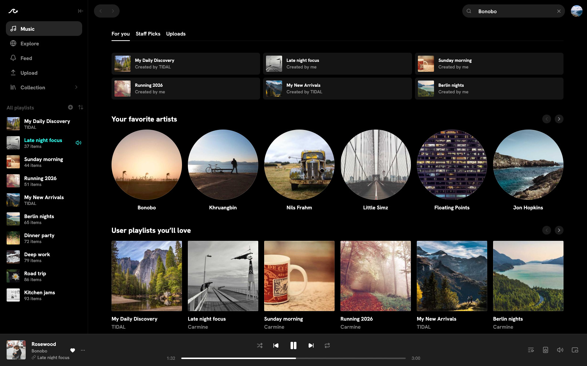
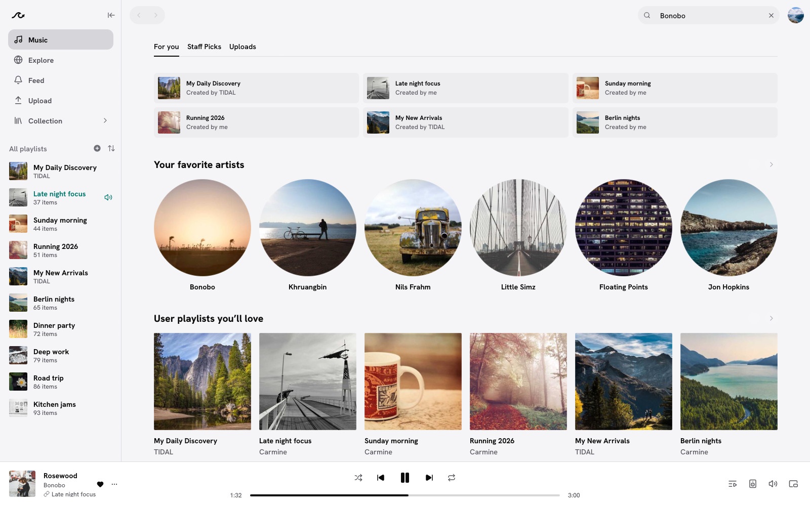
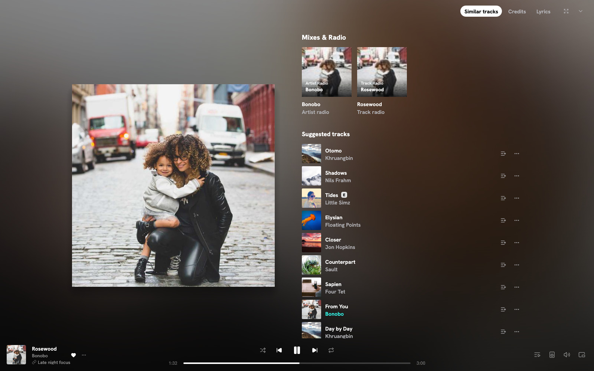
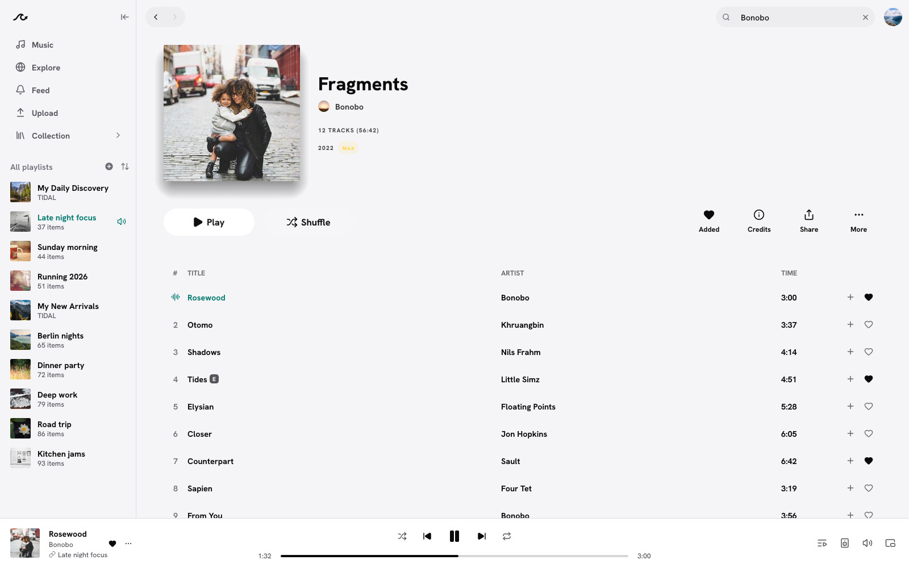

<div align="center">


# Tidalfast

**A native desktop client for TIDAL. Written in Rust, no browser inside.**

[](https://github.com/CIoudGuy/tidalfast/releases/latest)
[](https://github.com/CIoudGuy/tidalfast/releases)
[](LICENSE)
[](#install)
[](https://www.rust-lang.org)

[Install](#install) · [Features](#features) · [Screenshots](#screenshots) · [Plugins](#tidaluna-plugins) · [FAQ](#faq) · [Build](#build-from-source) · [Credits](#credits)

<br>

<picture>
  <source media="(prefers-color-scheme: light)" srcset="docs/assets/images/readme-home-light.jpg">
  
</picture>

**[▶ Watch the trailer](https://github.com/CIoudGuy/tidalfast/releases/download/v1.0.0/tidalfast-1.0.0-trailer.mp4)**

</div>

## Features

<table>
  <tr>
    <td width="33%"><b>Lossless and Max</b><br>16-bit FLAC and 24-bit hi-res, the streams TIDAL serves, decoded bit-exact.</td>
    <td width="33%"><b>Bit-perfect output</b><br>Optional exclusive mode (WASAPI, ALSA): your DAC gets each track at its own rate.</td>
    <td width="33%"><b>Fast and light</b><br>Opens in under a second, about 120 MB of memory, near 0% CPU when idle.</td>
  </tr>
  <tr>
    <td><b>Feels like TIDAL</b><br>Home, Explore, Feed, Collection, now playing with lyrics, credits and similar tracks.</td>
    <td><b>Music videos</b><br>Mixed into the queue with songs, picture-in-picture, up to 1080p.</td>
    <td><b>Offline</b><br>Download albums, playlists and mixes. Offline mode plays only your downloads.</td>
  </tr>
  <tr>
    <td><b>TIDAL Upload</b><br>Upload your own music and edit your releases, as in TIDAL's own Upload.</td>
    <td><b>My Activity</b><br>Your monthly top artists from TIDAL, plus what you played in Tidalfast.</td>
    <td><b>TidaLuna plugins</b><br>Optional. Install plugins and themes straight from the Luna stores.</td>
  </tr>
</table>

<details>
<summary><b>Everything else</b></summary>

<br>

- **Adaptive streaming.** When the connection can't keep up, the next songs stream lower until it recovers. On by default (Settings, Playback). Downloads keep their quality.
- **Downloads.** A few songs at a time, with progress ("Downloading 120 of 549"), pause and resume, and they carry on after a restart and follow later changes to a playlist.
- **Offline mode.** One switch (Settings, Downloads): no requests to TIDAL until you switch it off. It lasts across restarts.
- **Upload.** Make a single or add to a release by dropping audio files. Edit title, type, visibility, cover (or a spectrogram cover), tracks and artist name.
- **TIDAL's own settings.** Allow explicit content, Allow AI content, Audio metadata (BPM and key columns), Hide Uploads tab, Show collection in sidebar.
- **Equalizer, lyrics, credits.** In the now playing view and Settings.
- **Desktop integration.** System tray, media keys, launch at login (optional), start minimized.
- **16 languages.** English, Chinese (Simplified and Traditional), Dutch, French, German, Italian, Japanese, Polish, Portuguese (Brazil and Portugal), Russian, Spanish, Swedish, Turkish and Ukrainian.

</details>

## Screenshots

<table>
  <tr>
    <td width="50%"></td>
    <td width="50%"></td>
  </tr>
  <tr>
    <td align="center">Dark theme</td>
    <td align="center">Light theme</td>
  </tr>
  <tr>
    <td width="50%"></td>
    <td width="50%"></td>
  </tr>
  <tr>
    <td align="center">Now playing</td>
    <td align="center">Album page</td>
  </tr>
</table>

<sub>Screenshots use Tidalfast's built-in demo content.</sub>

## Install

Download from the **[latest release](https://github.com/CIoudGuy/tidalfast/releases/latest)**. Builds are for 64-bit Intel and AMD PCs (`x86_64`).

> [!NOTE]
> You need a TIDAL subscription to play music.

### Windows 10 and 11

| File | |
|---|---|
| `-setup.exe` | Installer. Adds Tidalfast to the Start menu, no administrator password needed. |
| `.zip` | Portable. Extract it and run `tidalfast.exe`. |

> [!TIP]
> SmartScreen may warn about an unknown publisher on first run. Choose **More info**, then **Run anyway**.

### Linux

| File | |
|---|---|
| `.AppImage` | One file: `chmod +x` it and run it. Adds itself to your app menu. |
| `.deb` / `.rpm` | Debian, Ubuntu, Fedora and similar. |
| `.tar.gz` | Unpack and run `tidalfast`. |

The AppImage, `.deb`, `.rpm` and `.tar.gz` need glibc 2.39 or newer (Ubuntu 24.04, Debian 13, Fedora 40 or later), ALSA, PulseAudio or PipeWire, and Wayland or X11.

## Quick start

1. Open Tidalfast and click **Log in**. Your browser opens with a code already filled in.
2. Approve it on TIDAL's page.
3. Press play.

For **Max** (24-bit), use **Log in with Max**, then choose *Settings, Playback, Quality, Max*.

<details>
<summary><b>Keyboard shortcuts</b></summary>

<br>

| Keys | Action |
|---|---|
| `Space` | Play or pause |
| `Ctrl+←` / `Ctrl+→` | Previous or next |
| `Shift+←` / `Shift+→` | Seek 10 seconds |
| `Ctrl+↑` / `Ctrl+↓` | Volume up or down |
| `M` | Mute or unmute |
| `B` | Add or remove the playing track from My Collection |
| `S` / `R` | Toggle shuffle / cycle repeat |
| `Q` / `L` | Show the queue / the lyrics |
| `Esc` | Lyrics: leave full screen |
| `Shift+↑` / `Shift+↓` | Track list: extend or shrink the selection |
| `Delete` | Remove from this playlist |
| `Ctrl+A` | Track list: select all |
| `Ctrl+C` / `Ctrl+X` / `Ctrl+V` | Copy, cut or paste track links |
| `Ctrl+F` or `/` | Search |
| `Ctrl+B` | Show or hide the sidebar |
| `Alt+←` / `Alt+→` | Back or forward |
| `Ctrl+H` / `Ctrl+L` | Home / Tracks |
| `Ctrl+Shift+A` / `Ctrl+Shift+B` | Go to the playing artist / album |
| `Ctrl+,` | Settings |
| `Ctrl+/` or `?` | All keyboard shortcuts |
| `Ctrl+W` / `Ctrl+Q` | Close the window / quit |

</details>

## TidaLuna plugins

Tidalfast runs plugins and themes made for [TidaLuna](https://github.com/Inrixia/TidaLuna), without a browser. It is **off by default**: turn it on in *Settings, Plugins (TidaLuna)*. From there you can browse the plugin stores, install from a URL, add CSS themes, and import your Luna settings.

- Plugins install over HTTPS only, and the Plugins page shows what each one has done (network, files, programs).
- A plugin asks before it runs a program, and can write to the clipboard only right after you click or press a key.
- Uninstalling a plugin removes the files it saved.
- Plugin downloaders and anything that touches DRM are not supported.

> [!WARNING]
> Plugins share one JavaScript engine, as in TidaLuna. Install only plugins you trust.

Making a plugin? See [Making plugins for Tidalfast](docs/_guide/making-plugins.md).

## FAQ

<details>
<summary><b>Is this official?</b></summary>
<br>
No. Tidalfast is an independent project and is not affiliated with TIDAL.
</details>

<details>
<summary><b>Lossless or Max?</b></summary>
<br>
<b>Log in</b> gives Lossless (CD quality). <b>Log in with Max</b> unlocks hi-res. Dolby Atmos is not supported.
</details>

<details>
<summary><b>What does bit-perfect do?</b></summary>
<br>
It hands the audio to your DAC untouched: no mixing, resampling, EQ or volume changes. Turn it on in <i>Settings, Playback</i>.
</details>

<details>
<summary><b>Do my plays count?</b></summary>
<br>
Yes. Plays are reported to TIDAL like the official apps do (you can turn this off). Music video plays count only in Tidalfast's own statistics for now.
</details>

## Build from source

You need [Rust](https://rustup.rs). The toolchain version is pinned in `rust-toolchain.toml`.

```sh
git clone https://github.com/CIoudGuy/tidalfast
cd tidalfast
cargo build --release
```

Linux also needs the usual audio and windowing development packages (ALSA, D-Bus, Wayland or X11); see [packaging](docs/_reference/packaging.md).

To try the interface without a TIDAL account, run the demo: `cargo run --features demo -- --demo`.

## Contributing

Bug reports, fixes and translations are welcome. Read [CONTRIBUTING.md](CONTRIBUTING.md) first; translations are explained in [translating](docs/_reference/translating.md).

## Credits

- Based on [Spotifast](https://github.com/crmne/spotifast) by Carmine Paolino and [its contributors](https://github.com/crmne/spotifast/graphs/contributors) (MIT).
- [fastframe](https://github.com/crmne/fastframe) by Carmine Paolino (MIT), the shared foundation for the interface, fonts, icons, tray and updates.
- [egui](https://github.com/emilk/egui) by Emil Ernerfeldt and contributors (MIT or Apache-2.0) and [winit](https://github.com/rust-windowing/winit) (Apache-2.0), through Carmine Paolino's forks ([egui](https://github.com/crmne/egui), [winit](https://github.com/crmne/winit)).
- [TidaLuna](https://github.com/Inrixia/TidaLuna) by Inrixia and contributors, whose plugin API Tidalfast follows. Plugin and theme authors are credited on each plugin in the Plugins page.
- Fonts: [Hanken Grotesk](https://github.com/marcologous/hanken-grotesk), [Inter](https://github.com/rsms/inter) and [Noto Emoji](https://github.com/googlefonts/noto-emoji), all under the SIL Open Font License 1.1 ([details](assets/fonts/README-fonts.txt)).
- Icons: [Lucide](https://lucide.dev) (ISC), some derived from [Feather](https://feathericons.com) by Cole Bemis (MIT) ([license](assets/icons/LICENSE.txt)).
- Turkish translation by Barış Berke Çetin.
- OpenH264 Video Codec provided by Cisco Systems, Inc. (downloaded from Cisco at run time outside Windows, for animated covers; not included in Tidalfast).
- Every Rust crate Tidalfast uses, with its license: [THIRD-PARTY.md](THIRD-PARTY.md).

Tidalfast was developed with the help of AI coding tools.

## License

[MIT](LICENSE). TIDAL is a trademark of its owner; Tidalfast is not affiliated with or endorsed by TIDAL.
